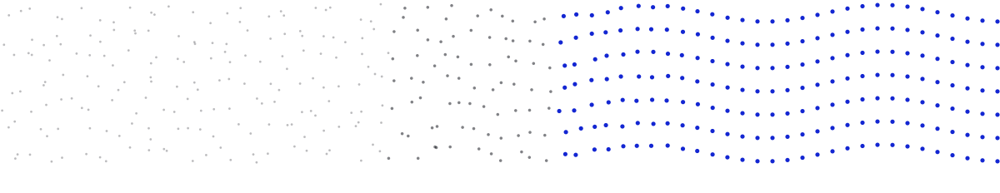

<picture>
  <source media="(prefers-color-scheme: dark)" srcset="assets/signal-dark.svg">
  
</picture>

I'm Kenee Patel (I go by Kenny), a software engineer in Halifax, Nova Scotia. These days I build whole products, from the interface down to the cloud setup. I did my master's in applied computer science at Dalhousie, and my thesis taught models to clean up noisy speech. That's what the dots up top are about.

Before Dalhousie I interned as an ML engineer at Kintu Designs in Gujarat, India, where I built a Vue and Flask tool that validated 55K records and cut manual data prep by 80%. Now I'm looking for a full-time software engineering role. If you're hiring, I'd love to hear from you at [patelkenee2804@gmail.com](mailto:patelkenee2804@gmail.com).

### Things I've built

- [Speech denoising](https://github.com/KeneePatel/AudioQuality-Denoising-Evaluator), my master's thesis at Dalhousie's MyTech Lab in summer 2025. I compared five ways to clean up noisy speech, from spectral subtraction and Wiener filtering to a U-Net I trained in TensorFlow, then scored each one on PESQ, STOI, and SNR across 824 held-out test pairs.
- [Serverless File Storage](https://github.com/KeneePatel/serverless-file-storage), a file storage app on AWS I built solo for a cloud computing course. You sign up through Cognito, upload a JPEG, PNG, or PDF up to 10 MB, and only you can see it. Terraform sets up all of it: six Lambda functions behind API Gateway, a Step Functions workflow that checks each upload, DynamoDB, S3, and the Next.js frontend on Elastic Beanstalk.
- [Microservices on GKE](https://github.com/KeneePatel/k8s-assignment), two Node.js services on a regional GKE cluster. The public one validates and stores CSV files, and the internal one adds up totals per product from the same 1 GiB persistent disk. Terraform builds the cluster, and Cloud Build tags every image with its commit SHA, so each rollback points at a known build.
- [FlexiGym](https://github.com/KeneePatel/flexi-gym), for booking a gym for a few days instead of signing up for a membership. A team of six built it. I did the Stripe checkout, the booking API, and the confirmation emails, and set up the Next.js frontend.
- [RoomM8](https://github.com/KeneePatel/room-m8), an app for roommates to split bills, settle up, assign chores, and share grocery lists. Four of us built it. My part was the Next.js frontend and the first versions of the settle-up, task, and profile services in Spring Boot, each with JUnit tests.

### Open source

From March to December 2024 I contributed to projects in the Starknet ecosystem. These got merged:

- [cairo-vm-df](https://github.com/ClementWalter/cairo-vm-df), a Cairo VM written in Google Apps Script. I moved it from JavaScript to TypeScript ([#10](https://github.com/ClementWalter/cairo-vm-df/pull/10)), then added memory segments for builtins ([#12](https://github.com/ClementWalter/cairo-vm-df/pull/12)), a `run` method ([#13](https://github.com/ClementWalter/cairo-vm-df/pull/13)), and the range-check ([#19](https://github.com/ClementWalter/cairo-vm-df/pull/19)) and bitwise ([#21](https://github.com/ClementWalter/cairo-vm-df/pull/21)) builtins.
- [Kakarot](https://github.com/kkrt-labs/kakarot), a zkEVM written in Cairo. I reworked the `exec_auth` tests to cover frames with and without an authority set ([#1139](https://github.com/kkrt-labs/kakarot/pull/1139)). Over in [kakarot-rpc](https://github.com/kkrt-labs/kakarot-rpc) I updated the Prometheus crates ([#1014](https://github.com/kkrt-labs/kakarot-rpc/pull/1014)).
- [Piltover](https://github.com/keep-starknet-strange/piltover), Starknet's core contracts in Cairo. I generated Rust bindings for them with cainome ([#28](https://github.com/keep-starknet-strange/piltover/pull/28)).
- [art/peace](https://github.com/keep-starknet-strange/art-peace), a shared art canvas on Starknet. I built the quest progress bar, which shifts from red to yellow as a quest gets closer to claimable ([#186](https://github.com/keep-starknet-strange/art-peace/pull/186)), and the status check for the NFT quest ([#233](https://github.com/keep-starknet-strange/art-peace/pull/233)).
- [starknet.quest](https://github.com/lfglabs-dev/starknet.quest): `QuestBanner` now takes a banner object instead of a quest ID ([#991](https://github.com/lfglabs-dev/starknet.quest/pull/991)).
- [Spotnet](https://github.com/djeck1432/spotnet): I added pagination to the position-history endpoint ([#401](https://github.com/djeck1432/spotnet/pull/401)).

### Smaller things

- [Healthcare access in Nova Scotia](https://github.com/KeneePatel/Datajam-SMU-26): I led a team of four at the 2026 SMU DataJam. We looked at whether parts of the province farther from hospitals see more emergency demand. Python, Pandas, and GeoPandas.
- [motion_tracking](https://github.com/KeneePatel/motion_tracking): watches a webcam and boxes anything that moves, by comparing each frame with the median of the last five. Python and OpenCV.
- [pixel-art-gen](https://github.com/KeneePatel/pixel-art-gen): turns images into pixel art. I wrote it to learn Rust.

What I reach for most: TypeScript, Next.js, Node.js, Python, Terraform, Docker, AWS, and GCP.

You can also find me on [LinkedIn](https://www.linkedin.com/in/patelkenee/).
